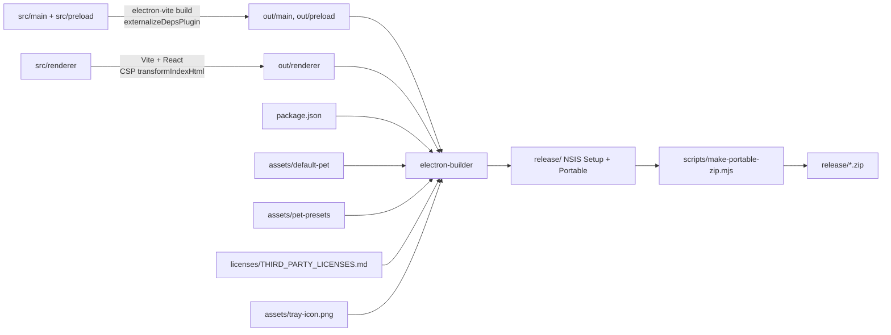

# 花伴 架构概览

> 状态：**当前事实**。本文按源码记录 2026-10-17、提交 `a635bb9` 的实际架构。
> 代码变化后必须同步本文；无法从源码确认的内容会标为“待核实”。
> 原始产品规划见 [docs/archive/Windows_桌宠个人助手_技术开发文档.md](../archive/Windows_桌宠个人助手_技术开发文档.md)，该文档已归档，不是当前实现清单。

## 1. 进程与职责边界

| 层            | 位置                | 职责                                                                                            | 明确不负责                                                            |
| ------------- | ------------------- | ----------------------------------------------------------------------------------------------- | --------------------------------------------------------------------- |
| Electron main | `src/main/`         | 应用生命周期、窗口、托盘、系统通知、配置/凭据/数据存储、外部 API 请求、调度、IPC 校验与错误映射 | 渲染界面、保存明文凭据到普通配置、向 renderer 暴露 Node/Electron 能力 |
| Preload       | `src/preload/`      | 按窗口视图暴露窄 `contextBridge` API；包装 `ipcRenderer.invoke/on`；解包 `IpcResult`            | 业务逻辑、凭据读取、任意 channel 或文件访问                           |
| Renderer      | `src/renderer/`     | React UI：桌宠、快捷菜单、气泡、设置页；收集输入、展示状态                                      | 直接访问 Node/Electron、外部 API、密钥、任意文件路径                  |
| Shared        | `src/shared/api.ts` | 主进程、preload、renderer 共享的类型、窗口视图和 IPC 通道名                                     | 保存凭据或运行时状态                                                  |

窗口统一通过 `src/main/security/web-preferences.ts` 创建，关键选项为：

- `nodeIntegration: false`
- `contextIsolation: true`
- `sandbox: true`
- `webviewTag: false`
- `navigateOnDragDrop: false`
- `additionalArguments: ['--fb-view=<view>']`

`src/main/index.ts` 还统一拒绝所有权限请求：

```ts
session.defaultSession.setPermissionRequestHandler((_webContents, _permission, callback) =>
  callback(false)
)
session.defaultSession.setPermissionCheckHandler(() => false)
```

> 两个自定义 scheme 在 app ready 前通过一次 `registerSchemesAsPrivileged()` 统一声明；所有应用窗口通过 `security/navigation-guards.ts` 拒绝新窗口、外部顶层导航和重定向，只允许加载应用自身页面。

## 2. 目录与关键入口

```text
src/
  main/
    index.ts                     # 启动、依赖装配、单实例、退出清理
    app-controller.ts            # 窗口/模块/托盘/动作的协调者
    actions/module-action-runner.ts
    ipc/register-handlers.ts     # 所有 ipcMain.handle 注册
    ipc/schemas.ts               # Zod 输入 schema
    ipc/validate-sender.ts       # senderFrame.url 校验
    modules/
      registry.ts                # 静态模块注册表
      module-manager.ts          # enabled && configured 生命周期
      types.ts                   # ModuleDefinition / ModuleContext
      memo/ interval-reminder/ esa/ deepseek/ website-check/
    protocol/app-schemes.ts
    protocol/pet-asset-protocol.ts
    protocol/memo-image-protocol.ts
    shortcuts/global-shortcuts.ts
    scheduler/task-scheduler.ts
    security/
      web-preferences.ts
      navigation-guards.ts
      secret-store.ts
      secret-ids.ts
      safe-storage-backend.ts
    shared/errors.ts
    shared/logger.ts
    storage/
      config-store.ts
      config-schema.ts
      json-store.ts
      pet-assets.ts
      memo-images.ts
    tray/tray.ts
    updates/
      update-service.ts          # 更新状态机与用户确认流程
      electron-updater-adapter.ts # electron-updater / GitHub / generic feed
    windows/
      pet-window.ts
      pet-window-controller.ts
      settings-window.ts
      memo-card-window.ts
      memo-card-window-manager.ts
      memo-card-geometry.ts
      overlay-windows.ts
      overlay-window-manager.ts
      geometry.ts
      load-view.ts
  preload/
    index.ts                     # contextBridge 入口
    api.ts                       # createBridge / 按视图创建 API
    index.d.ts                   # window.*Api 类型声明
  renderer/
    index.html                   # CSP 占位符与 Vite 入口
    src/
      main.tsx                   # React 根与全局样式
      App.tsx                    # 按 ?view= 选择视图
      pet/ menu/ bubbles/ memo-card/  # 常驻视图与桌面备忘卡片
      settings/                  # 懒加载设置应用：核心导航 + 启用模块导航、7 个页面组件、5 个状态 hook
      components/                # Button / Field / Tag / EmptyState 等
      styles/                    # tokens.css + 各视图样式
  shared/api.ts                  # 共享类型与 IPC_CHANNELS
tests/unit/                      # Vitest 单元测试
website/                         # 独立 VitePress 官网，不参与 Electron 打包
scripts/                         # 图标、默认形象、许可证、便携 ZIP
```

## 3. 启动与退出流程

启动入口为 `src/main/index.ts` 的 `bootstrap()`：

1. 设置 AppUserModelID、浅色主题，移除应用菜单。
2. 拒绝所有权限请求，并监听 `web-contents-created` 为每个应用窗口安装导航与新窗口防护。
3. 在 `app.getPath('userData')` 下创建并加载：`Logger`、`ConfigStore`、`SecretStore`、`JsonStore`（备忘录/定时提醒/网站）与 `MemoImageStore`；旧的 `data/dates.json` 和 `data/gmail-state.json` 会在此时删除，旧 Gmail 凭据也会从 `secrets.enc.json` 清理，定时提醒在首次加载时写入默认“喝水”提醒。
4. 创建 `TaskScheduler`、各业务 service/module、`ModuleManager` 和 `AppController`。
5. 注册桌宠与备忘录图片协议处理器、IPC handlers；两个自定义 scheme 已在 `app.ready` 前通过 `registerAppSchemes()` 一次性声明。
6. 监听 `powerMonitor` 的 `resume`，调用 `ModuleManager.handleResume()` 重新计时。
7. `AppController.start()`：应用开机启动设置、创建桌宠窗口、托盘、启动模块、注册全局快捷键、同步桌面备忘卡片，并监听显示器变化。

单实例：

- `app.requestSingleInstanceLock()` 失败时直接退出。
- 第二个实例触发 `second-instance`，已有实例显示桌宠并打开设置。

退出：

- 关闭所有窗口不会退出应用（`window-all-closed` 为空实现），符合“桌宠常驻托盘”的产品设计。
- `before-quit` 中调用 `AppController.flush()` 写入待保存数据，再调用 `dispose()` 停止模块、动作计时器、overlay、屏幕监听和托盘。

## 4. 窗口与 renderer 视图

一个 Vite renderer 工程通过 `?view=` 渲染五种视图；窗口类型与视图一一对应：

| 视图        | 窗口创建                      | 加载方式                           | 主要行为                                                                                                                          |
| ----------- | ----------------------------- | ---------------------------------- | --------------------------------------------------------------------------------------------------------------------------------- |
| `pet`       | `windows/pet-window.ts`       | `loadView(..., view: 'pet')`       | 透明、无边框、默认置顶、不可聚焦、拖动与点击打开菜单                                                                              |
| `menu`      | `windows/overlay-windows.ts`  | 按需创建，首帧加载完成或超时后显示 | 优先桌宠上方、下方回退；4 图标 + 悬停展开的动作列表；窗口按展开高度一次定位；指针离开菜单与桌宠一段时间后自动关闭；再次右键不切换 |
| `bubble`    | `windows/overlay-windows.ts`  | 按需创建，首帧加载完成或超时后显示 | `showInactive()`，接收 `bubble:update` 推送                                                                                       |
| `settings`  | `windows/settings-window.ts`  | 单例窗口，780×720，最小 640×540    | 顶部 功能/设置/关于；功能页左侧模块导航显示业务内容，设置页左侧常规/功能/模块设置；关于页显示版本、作者、仓库、反馈与应用更新状态 |
| `memo-card` | `windows/memo-card-window.ts` | 每条锚定备忘录一个窗口             | 透明无边框、始终置顶、可聚焦；标题栏拖动、四角自定义缩放、完成与取消锚点；内容由 `memo-card:state-changed` 同步                   |

加载规则（`windows/load-view.ts`）：

- 开发环境：`<devServerUrl>/?view=<view>`，备忘卡片额外带 `memoId`。
- 生产环境：`loadFile(rendererIndexPath, { query: { view, ...query } })`。

preload 通过 `--fb-view=<view>` 参数决定暴露哪个 API：

| 视图        | 暴露对象             | 类型          |
| ----------- | -------------------- | ------------- |
| `pet`       | `window.petApi`      | `PetApi`      |
| `menu`      | `window.menuApi`     | `MenuApi`     |
| `bubble`    | `window.bubbleApi`   | `BubbleApi`   |
| `settings`  | `window.settingsApi` | `SettingsApi` |
| `memo-card` | `window.memoCardApi` | `MemoCardApi` |

`src/preload/index.ts` 与 `src/renderer/src/App.tsx` 分别从启动参数和 URL 查询参数读取视图，两者由 `loadView` 保证一致。新增视图时必须同时修改 `WindowView`、`IPC_CHANNELS`/API 类型、`BRIDGE_KEYS`、`App.tsx` 和窗口创建逻辑。

## 5. IPC 方向、校验与响应

### 5.1 调用方向

```mermaid
flowchart LR
  subgraph Renderer[Renderer 不可信 UI]
    R[React 视图]
  end
  subgraph Preload[Preload 窄桥]
    P[window.petApi / menuApi / bubbleApi / settingsApi / memoCardApi]
  end
  subgraph Main[Electron main 可信层]
    H[ipc/register-handlers.ts]
    C[AppController]
    M[ModuleManager]
    S[TaskScheduler]
    X[业务 service / 外部 API]
    W[窗口 / 托盘 / overlay]
    D[ConfigStore / JsonStore / SecretStore]
  end

  R -->|调用 API| P
  P -->|ipcRenderer.invoke(channel, input)| H
  H -->|sender 校验 + Zod 校验| C
  C --> M
  M --> S
  M --> X
  C --> W
  C --> D
  H -->|IpcResult<T>| P
  P -->|解包或抛出 PublicError| R
  W -->|pet:state-changed / bubble:update| P
```

### 5.2 请求响应

`register-handlers.ts` 为每个 channel 包装统一逻辑：

1. `assertTrusted(event)`：`event.senderFrame?.url` 必须是打包后的 `index.html` 文件 URL，或开发服务器 origin（`validate-sender.ts`）。
2. 有 schema 时执行 `parseInput`；失败抛 `AppError('INVALID_INPUT', ...)`。
3. 成功返回 `{ ok: true, value }`。
4. 失败通过 `toPublicError` 返回 `{ ok: false, error: { code, message, retryable } }`，并记录不含敏感字段的 warn 日志。

preload 的 `unwrapResult` 把 `IpcResult` 解包；失败时抛出一个可序列化的普通对象（保留 `code`/`message`/`retryable`），因为 `contextBridge` 会丢弃自定义 Error 属性。

### 5.3 推送

主进程向 renderer 主动发送的事件只有：

- `pet:state-changed` → `pet` 视图（形象与弹跳设置变化）。
- `bubble:update` → `bubble` 视图（`BubblePayload`）。
- `menu:presentation` → `menu` 视图（`MenuPresentation`：打开/关闭阶段、上下方向、递增 token）。
- `memo-card:state-changed` → 对应备忘卡片（文本、提醒时间、图片、锁定状态）。
- `memos:changed` → 设置窗口（备忘录数据变化，触发重新拉取）。
- `settings:open-memo-composer` → 设置窗口（快捷键请求新建备忘录；渲染进程通过 `settings:ui-ready` 握手后才会收到）。
- `settings:navigate` → 设置窗口（打开功能/设置/关于 tab，或定位到指定模块/设置分区）。
- `updates:changed` → 设置窗口（应用更新状态变化）。

`menu` 视图在挂载时通过 `menu:ready` 握手获取当前表现状态，避免首次打开时推送早于订阅。菜单窗口只在首次打开时创建并 `show()` 一次，之后不再隐藏：关闭时把面板动画到完全透明，并让窗口忽略鼠标事件、释放焦点；重开时只切换面板内容，renderer 通过 `menu:opened` 确认新面板已提交后主进程才重新接收鼠标事件。这样可以避开 Windows 对工具窗口的显示过渡——隐藏后再次 `show()` 时系统会先呈现上一次缓存的画面，看起来就像菜单连续加载了两次。菜单窗口在打开时按“展开动作列表”的高度一次性定位并显示；之后展开/收起只由 renderer 切换内容，不再改变窗口尺寸，因此可见窗口不会因 resize 闪烁。面板只在首次打开时挂载，之后保持挂载并在每次关闭/重开时复用，不会重新加载内容；每次打开（含重开）都由根节点从关闭态切回打开态重新触发表格的错峰入场动画，关闭时播放退场动画（执行动作等需要立即隐藏的场景除外）。主进程在菜单打开期间轮询指针位置：只有指针同时离开菜单窗口和桌宠窗口超过 `MENU_IDLE_CLOSE_MS` 才播放退场并隐藏内容；再次右键不会关闭菜单。

renderer 不通过 IPC 主动请求外部网络；所有外部请求由主进程发起。

### 5.4 通道定义

所有通道名集中在 `src/shared/api.ts` 的 `IPC_CHANNELS`，按前缀分组：`app:`、`config:`、`settings:`、`modules:`、`security:`、`updates:`、`memos:`、`memo-card:`、`interval-reminders:`、`websites:`、`deepseek:`、`esa:`、`menu:`、`pet:`、`bubble:`。关于页外链使用 `app:open-external`，只接受 `author` / `repository` / `issues` / `releases` 四个固定 ID；菜单“功能”通过 `menu:open-functions` 打开系统页功能 tab。

新增 IPC 的最小改动面：

1. `IPC_CHANNELS` 增加通道名。
2. `src/shared/api.ts` 增加输入/输出类型和对应 `*Api` 方法。
3. `src/preload/api.ts` 增加调用包装。
4. `src/main/ipc/schemas.ts` 增加 Zod schema。
5. `src/main/ipc/register-handlers.ts` 注册 handler，并由 `AppController` 暴露方法。
6. 更新测试、架构文档和手动测试计划。

## 6. 模块生命周期与调度

### 6.1 静态注册表

`src/main/modules/registry.ts` 返回固定模块数组，不读取文件系统、不执行动态插件代码：

- `MemoModule`（含提醒定时器，通过 `ModuleContext.notify` 请求桌宠气泡提示）
- `IntervalReminderModule`（按间隔检查定时提醒，通过 `ModuleContext.notify` 请求常驻气泡）
- `EsaModule`
- `DeepSeekModule`
- `WebsiteCheckModule`

每个模块实现 `ModuleDefinition`（`src/main/modules/types.ts`）：

```ts
interface ModuleDefinition {
  id: ModuleId
  name: string
  description: string
  requiresCredentials: boolean
  implemented: boolean
  actions: ModuleActionDefinition[]
  isConfigured(): boolean
  getStatus(): ModuleStatus
  start(context: ModuleContext): void
  stop(): void
  handleResume?(): void
  runAction?(actionId: string): Promise<ModuleActionResult>
}
```

### 6.2 ModuleManager

`ModuleManager`（`src/main/modules/module-manager.ts`）是生命周期的唯一协调者：

- 只有 `enabled && isConfigured()` 的模块会被 `start()`。
- `setEnabled()`、`refresh()` 会停止并重新同步对应模块。
- `stopModule()` 会调用模块 `stop()`，再 `scheduler.stopByOwner(module.id)`。
- `getMenuActions()` 只列出 `implemented && configured && enabled` 且有动作的模块。
- `runAction()` 会再次校验模块实现、配置和启用状态，并抛出 `UNKNOWN_ACTION` / `NOT_CONFIGURED` / `MODULE_DISABLED`。

### 6.3 TaskScheduler

`src/main/scheduler/task-scheduler.ts` 的特性：

- 每个任务一条 `setTimeout` 链；同一任务不会重叠运行。
- 失败后按 `intervalMs * 2^failures` 指数退避，上限默认 30 分钟。
- `stop()` / `stopByOwner()` / `stopAll()` 清 timer 并 `AbortController.abort()` 中止在途任务。
- `handleResume()` 在系统休眠恢复后从当前时间重新计时，不补发错过的执行。
- 业务模块通过 `ModuleContext.scheduler` 注册任务，不自行创建永久 `setInterval`。

当前任务来源：

| 模块     | 任务                     | 间隔                           | 备注                 |
| -------- | ------------------------ | ------------------------------ | -------------------- |
| DeepSeek | `deepseek:refresh`       | 5–60 分钟或关闭                | 配置了刷新间隔才注册 |
| ESA      | `esa:refresh`            | 5–60 分钟或关闭                | 配置了刷新间隔才注册 |
| 网站检测 | `website-check:<id>`     | 每个启用且设置了间隔的网站一条 | 配置变化后重建任务   |
| 定时提醒 | 无（模块内部 5 秒 tick） | 每个提醒按配置间隔 ± 随机值    | 仅在生效时间段内触发 |

### 6.4 快捷菜单动作与气泡

- 菜单默认展示 4 个图标（功能、设置、隐藏桌宠、退出）；悬停“功能”展开 `ModuleManager.getMenuActions()` 的结果，点击“功能”打开系统页功能 tab；点击“设置”打开系统页设置 tab。
- 备忘录模块已启用且已配置时，`AppController.getMenuActions()` 会在动作列表最前加入“新建备忘录”（`memo:new`）；`runMenuAction` 直接复用 `openMemoComposer()`，与 `Alt+A` 共用同一新建流程，避免两套验证/保存逻辑。
- 菜单几何由 `src/main/windows/geometry.ts` 的 `computeMenuLayout()` 计算，尺寸/动效常量集中在 `src/shared/menu-layout.ts`，主进程与 renderer 共用。
- `ModuleActionRunner`（`src/main/actions/module-action-runner.ts`）负责：
  - 生成 `requestId`，新请求使旧结果失效；
  - 先显示 loading 气泡，再显示 success/empty/error；
  - 45 秒安全超时；
  - 按 `app.bubbleDurationMs` 自动隐藏；
  - 有前台动作或桌宠不可见时，后台通知不抢占气泡。
- 气泡由 `OverlayWindowManager` 维护为一个栈：新气泡追加到末尾（界面从上到下按出现顺序），更新相同 `requestId` 只替换内容；普通气泡按 `app.bubbleDurationMs` 单独自动隐藏；指针位于桌宠或气泡窗口上时暂停计时，离开后继续，`persistent` 气泡（备忘录/定时提醒）不自动隐藏，需点击“知道了喵”。窗口高度由 renderer 测量后通过 `bubble:set-height` 上报，主进程据此向上扩展并重新定位；超过上限时列表内部滚动。气泡显示或重新定位后会调用 `moveTop()`，确保与快捷菜单窗口重叠时仍位于菜单之上、按钮可点击。
- 网站检测快捷动作按启用顺序逐行输出每个站点的结果：成功为“名称：正常，123ms”，失败为“名称：异常，原因”；结果片段通过 `ModuleActionResult.emphasis` 在气泡中以棕色粗体显示。

### 6.5 备忘录、提醒与桌面卡片

- `MemoService`（`modules/memo/memo-service.ts`）负责 CRUD、排序与完成状态：有提醒的未完成项按提醒时间升序，其次无提醒项按创建时间倒序，最后是完成项按完成时间倒序；完成会取消锚点，已完成项可再次取消完成，删除会同时删除其图片文件。设置页在完成/取消完成时只就地更新数据、不立即重排，离开并重新进入备忘录页时才按服务端顺序刷新。
- `MemoModule.start()` 为最早到期的提醒安排一次 `setTimeout`，另有 30 秒安全轮询；触发后通过 `ModuleContext.notify(..., { persistent: true })` 请求常驻桌宠气泡，并写入 `remindedAt` 防止重复提醒。修改提醒时间会清除 `remindedAt`；系统恢复时 `handleResume()` 会立即补查。
- `MemoCardWindowManager`（`windows/memo-card-window-manager.ts`）为每条 `anchored && !completed` 的备忘录维护一个 `memo-card` 窗口。新卡片默认从主显示器右上角开始，按“先向下、满列后向左”的网格寻找不重叠的位置并持久化；已有位置在未被其他卡片占用时保留。卡片高度在窗口创建时由 renderer 按正文内容测量并通过 `memo-card:fit-height` 回写，约为正文高度加一行空行。窗口使用自定义拖动与四角缩放 IPC（主进程读取系统光标位置），结束时把位置/尺寸写回 `MemoService`；模块停用、删除、完成或取消锚点时关闭对应窗口，显示器变化时重新限制到可见区域。
- 同时锚定的未完成备忘卡片上限为 20 张：`sanitizeMemoData` 在加载旧数据时会取消超出上限条目的锚定状态，`MemoService.setAnchored` 对第 21 张返回明确错误。
- 卡片操作列固定为 **加号 → 锁 → 完成 → 关闭**：加号复用 `openMemoComposer()`；锁状态持久化到 `data/memos.json`（schemaVersion 3），锁定时卡片窗口使用 `setIgnoreMouseEvents(true, { forward: true })`，仅指针移到锁按钮时恢复交互；关闭取消锚定并保留备忘录数据；托盘菜单提供“解锁全部桌面卡片”作为备用入口。
- 右键卡片正文或标题进入正文原位编辑：卡片正文变为 textarea，700 ms 防抖自动保存，点击“完成”、按 Esc/Ctrl+Enter 或失去焦点时立即保存；保存失败保留编辑内容并提示。编辑期间禁用拖动、缩放与加号/锁/完成/关闭，正文高度变化会重新测量并回写窗口高度；图片仍使用功能页的现有编辑器处理。
- 逐行打勾是每条备忘录自己的 `lineTasksEnabled` 字段，`modules.memo.lineTasksEnabled` 只作为新建时的默认值。开启后卡片每个非空行前显示复选框；空行不生成任务，图片不参与。行任务保存稳定 ID、文本和完成状态，编辑正文时按完全匹配的行文本保留状态，新行默认未完成，删除的行状态清除。整张备忘录的完成状态与逐行状态互不自动联动。
- 全局快捷键由 `shortcuts/global-shortcuts.ts` 注册。备忘录快捷键默认 `Alt+A`，保存在 `config.app.memoShortcut`；界面入口是备忘录页标题旁的齿轮设置弹窗，不出现在常规页；新建弹窗中的“创建后锚定到桌面”开关会把偏好写入 `modules.memo.anchorNewMemos`，创建后立即锚定。冲突时保留原快捷键并返回 `INVALID_INPUT`。触发后打开设置；渲染进程通过 `settings:ui-ready` 握手，主进程再发送 `settings:open-memo-composer` 切换到备忘录页并弹出新建弹窗。老板键默认 `Alt+Z`，保存在 `config.app.bossShortcut`，在常规页修改；按下后隐藏桌宠、菜单/气泡、设置窗口、桌面备忘卡片和托盘图标，再按一次恢复（设置窗口与卡片按原状态恢复），托盘通过 `AppTray.destroy()` / `create()` 幂等重建。

### 6.6 ESA 快捷流量范围

- ESA 快捷动作按 `modules.esa.displayRanges` 选择过去 24 小时、7 天、30 天中的一个或多个滚动窗口，逐个调用 `DescribeSiteTimeSeriesData` 并汇总 `Traffic`；设置页与快捷气泡只展示勾选的范围，至少保留一项。

### 6.7 定时提醒

- `IntervalReminderService`（`modules/interval-reminder/`）保存多个提醒；首次启动（`seeded=false`）写入默认关闭的“喝水”提醒，之后即使用户删除全部提醒也不会重复写入。
- 提醒配置包括名字、气泡文本、开关、间隔（分钟）、生效时段数组和 `±N` 分钟随机值。间隔 30 分钟、随机值 5 分钟时，实际间隔在 25–35 分钟之间随机。
- `IntervalReminderModule` 每 5 秒检查一次：为每个启用提醒计算下次时间；到期且处于生效时段时通过 `ModuleContext.notify(text, { persistent: true, id })` 显示常驻气泡并记录 `lastFiredAt`，其中 `id` 为 `interval-reminder:<reminderId>`；同一提醒重复触发会更新原气泡，不会无限新增相同条目。到期但不在时段内时顺延到下一个时段开始；系统恢复时立即补查。新建提醒默认不设置生效时段（全天生效），避免用户未注意默认时段导致提醒不触发。
- 生效时段为本地 `HH:mm`，支持跨午夜范围；时段为空表示全天生效。提醒不经过 `TaskScheduler`，避免分钟级间隔被调度器的指数退避/重叠策略影响。

### 6.8 应用更新

- `UpdateService`（`updates/update-service.ts`）包装 `electron-updater`，只在打包的 Windows 安装版启用；开发环境和便携版（检测 `PORTABLE_EXECUTABLE_DIR` / `PORTABLE_EXECUTABLE_FILE`）返回 `unsupported`，不会发起网络请求。
- 默认使用 GitHub provider（`ZaiHuaOvO/FlowerBuddy`）的稳定通道；设置环境变量 `FLOWERBUDDY_UPDATE_URL` 时改用 generic provider，便于后续切换到国内对象存储/CDN 镜像，无需改更新逻辑。
- `autoDownload=false`、`autoInstallOnAppQuit=false`、`allowPrerelease=false`、`allowDowngrade=false`；由用户在关于页手动检查、下载并确认重启安装。
- 状态为 `idle / checking / available / not-available / downloading / downloaded / error / unsupported`；下载进度通过 `updates:changed` 推送到设置窗口。错误只向 UI 展示通用重试提示，原始错误写入脱敏日志，并提供 Release 手动下载入口。
- Release 工作流上传 `latest.yml` 与 blockmap；在真实签名的 Windows 安装包完成至少两个版本升级验证前，此功能按计划标记为实验/待验证，不宣称发布级完成。

## 7. 数据、凭据与日志

所有可变数据写入 `app.getPath('userData')`，不写入安装目录：

| 文件/目录                      | 内容                                                                                                                                               | 写入者                            | 安全处理                                                                                                                                                                                                                                                                                                                                                                                                                                                  |
| ------------------------------ | -------------------------------------------------------------------------------------------------------------------------------------------------- | --------------------------------- | --------------------------------------------------------------------------------------------------------------------------------------------------------------------------------------------------------------------------------------------------------------------------------------------------------------------------------------------------------------------------------------------------------------------------------------------------------- |
| `config.json`                  | 应用设置、桌宠配置（含自定义形象名称 `pet.names`）、模块开关、启用模块顺序（`app.moduleOrder`）、全局快捷键、非敏感配置（如 ESA SiteId、轮询间隔） | `ConfigStore`                     | `schemaVersion` 当前为 11；v5 的 `dates` 模块会在迁移时映射为 `memo`，v8 迁移会把模块选择重置为“备忘录 + 定时提醒”，v9 移除 Gmail 模块及其在模块顺序中的残留 ID，v10 为桌宠自定义形象增加名称表并新增老板键 `app.bossShortcut`，v11 增加备忘录逐行完成默认开关 `modules.memo.lineTasksEnabled`；备忘录的“创建后锚定”偏好保存在 `modules.memo.anchorNewMemos`；Zod 修复非法值并归一化模块顺序；未来版本/损坏文件备份后重置；150 ms 防抖；临时文件 + rename |
| `secrets.enc.json`             | 加密后的 API Key、AccessKey                                                                                                                        | `SecretStore`                     | 仅保存 Base64 密文；`safeStorage` 异步加密；不可用时拒绝保存，不回退明文                                                                                                                                                                                                                                                                                                                                                                                  |
| `data/memos.json`              | 备忘录文本、提醒、完成状态、锚点、锁定、逐行任务状态、逐行勾选开关与卡片位置                                                                       | `JsonStore<MemoData>`             | `sanitizeMemoData` 修复非法输入；最多 500 条；同时锚定最多 20 条，超出时自动取消锚定；旧数据缺少 `locked` 时按未锁定处理，缺少 `lineTasks` 时按正文行生成未完成任务，缺少 `lineTasksEnabled` 时使用当前默认开关；原子写入                                                                                                                                                                                                                                 |
| `data/interval-reminders.json` | 定时提醒的名称、文本、开关、间隔、生效时段、随机值与上次触发时间                                                                                   | `JsonStore<IntervalReminderData>` | `sanitizeIntervalReminderData` 修复非法输入；最多 100 条；首次创建时写入默认“喝水”提醒；原子写入                                                                                                                                                                                                                                                                                                                                                          |
| `data/website-checks.json`     | 网站检测配置与最近结果                                                                                                                             | `JsonStore<WebsiteData>`          | `sanitizeWebsiteData`；结果只保留展示字段                                                                                                                                                                                                                                                                                                                                                                                                                 |
| `pets/<uuid>.png`              | 用户导入的桌宠图片                                                                                                                                 | `storage/pet-assets.ts`           | 支持 PNG/JPEG 导入，JPEG 统一转为 PNG；≤15 MB，尺寸 ≤8192；随机 UUID 文件名                                                                                                                                                                                                                                                                                                                                                                               |
| `memo-images/<uuid>.png`       | 备忘录粘贴的图片                                                                                                                                   | `storage/memo-images.ts`          | 仅 PNG，≤10 MB，尺寸 ≤4096；随机 UUID；删除备忘录时清理；启动时清理未引用文件                                                                                                                                                                                                                                                                                                                                                                             |
| `logs/app.log`                 | JSON Lines 脱敏日志                                                                                                                                | `Logger`                          | 密钥/token 等脱敏；2 MB 轮转；保留 7 天                                                                                                                                                                                                                                                                                                                                                                                                                   |

内置桌宠形象随应用分发，位于 `assets/default-pet/` 与 `assets/pet-presets/`（开发时为仓库根目录，打包后位于 `app.asar`），只读且不复制到 userData。`config.pet.assetId` 可为 `default`、预设 ID（如 `preset-cat-pair`）或用户导入图片的 UUID；解析与白名单校验集中在 `storage/pet-assets.ts`。设置页通过 `settings:list-pet-images` 按上传时间列出 `pets/` 中的 UUID 图片及 `pet.names` 中的自定义名称，通过 `settings:select-pet-asset` 切换任意可解析形象，通过 `settings:delete-pet-image` 删除用户图片（同时清理名称），通过 `settings:rename-pet-image` 保存名称；删除当前形象时自动回退到 `default`。`flowerbuddy-pet://` 协议仅接受预设 ID 或 `pets/` 下存在的 UUID 文件。

凭据 ID（`src/main/security/secret-ids.ts`）：

- `deepseek.apiKey`
- `esa.accessKeyId`
- `esa.accessKeySecret`

凭据只在主进程读取；`SecretStore` 对 ID 做格式校验，密文以外不落盘。渲染进程没有读取明文的 IPC 接口。

桌宠与备忘录图片访问：

- `flowerbuddy-pet://asset/<assetId>` 与 `flowerbuddy-memo://image/<imageId>` 在 app ready 前由 `protocol/app-schemes.ts` 一次性注册为 privileged scheme。
- `handlePetAssetRequests` 只接受当前配置的 assetId 或内置 `default`；`resolvePetAssetPath` 只解析内置路径或 UUID 文件名，无法读取任意文件。
- `handleMemoImageRequests` 只接受备忘录图片目录中的 UUID 文件名。

## 8. 外部网络访问

| 服务       | 目标                                                                   | 触发条件                                               | 超时/限制                                                               |
| ---------- | ---------------------------------------------------------------------- | ------------------------------------------------------ | ----------------------------------------------------------------------- |
| DeepSeek   | `GET https://api.deepseek.com/user/balance`                            | 模块启用且已配置 API Key，用户手动查询或设置了刷新间隔 | 15 秒；401/402/429/5xx 映射为 `AppError`                                |
| 阿里云 ESA | 官方 SDK `@alicloud/esa20240910`，端点 `esa.cn-hangzhou.aliyuncs.com`  | 模块启用、AccessKey 与 SiteId 已配置                   | 连接 5 秒、读取 15 秒；本地自然日 00:00 到现在转 UTC；`Traffic` / `ALL` |
| 网站检测   | 用户自行添加的 HTTP(S) URL                                             | 用户手动检测或启用定时检测                             | 3–30 秒；手动跟随最多 5 次重定向；不读取响应正文                        |
| 应用更新   | GitHub Releases（默认）或 `FLOWERBUDDY_UPDATE_URL` 指定的 generic feed | 用户在关于页手动检查/下载更新；仅打包 Windows 安装版   | 使用 electron-updater 默认超时；便携版与开发环境不发起请求              |

## 9. 构建与打包数据流



事实要点：

- `electron.vite.config.ts` 对 main/preload 使用 `externalizeDepsPlugin()`；renderer 使用 React 插件和 CSP 注入插件。
- main 构建额外把 `bufferutil` / `utf-8-validate` 标记为 Rollup external：阿里云 ESA SDK 的 `ws` 依赖会可选加载这两个原生模块，未安装时 `ws` 自动回退到纯 JS；直接打包会在解析阶段失败。
- 开发 CSP 允许 React Refresh 内联脚本和本地 HMR WebSocket；生产 CSP 为 `default-src 'none'`、`script-src 'self'`。
- `electron-builder.yml`：`asar: true`，打包 `out/**/*`、`package.json`、`assets/default-pet/**/*`、`assets/pet-presets/**/*`，输出到 `release/`；Windows x64 生成 NSIS 和 portable。
- NSIS 安装程序使用 `assets/installer/sidebar.bmp`（164×314）和 `header.bmp`（150×57）作为品牌侧边栏与顶部图，由 `scripts/generate-installer-assets.ps1` 生成；`assets/installer.nsh` 增加中文欢迎页，并在 `Software\<APP_GUID>` 缺失时从卸载注册表恢复旧安装目录。electron-builder 本身会读取 `InstallLocation`、先运行旧卸载程序再覆盖安装；`deleteAppDataOnUninstall: false` 保证 `%APPDATA%\FlowerBuddy` 中的设置、凭据、备忘录和桌宠图片不被删除。
- `extraResources` 带入第三方许可证和托盘图标。
- `scripts/make-portable-zip.mjs` 在 `dist:win` 末尾生成便携 ZIP。
- `ci.yml` 在 `windows-latest` 对 `main`、Pull Request 和手动触发运行 typecheck、lint、format:check、test、build；手动触发时额外打包并上传短期 Artifact。
- `release.yml` 在推送 `v*` 标签时校验标签与 `package.json` 版本一致，运行同一组检查并执行 `dist:win`，生成 `SHA256SUMS.txt` 后创建或更新草稿 GitHub Release，附上 Setup、Portable 与 ZIP；维护者审核 Release notes 和附件后手动发布。发布步骤见 [development/release-process.md](../development/release-process.md)。
- `website/` 是独立 VitePress 站点，`base` 固定为 `/FlowerBuddy/`，不参与 Electron 打包；`.github/workflows/website.yml` 在 `website/**` 变化时构建，部署 job 由仓库变量 `WEBSITE_DEPLOY_ENABLED=true` 或手动触发控制。生产访问地址为 `https://zaihuaovo.github.io/FlowerBuddy/`，由 GitHub Pages 直接提供。

## 10. 依赖方向与禁止的反向依赖

允许的方向：

```text
shared  ←  main
shared  ←  preload
shared  ←  renderer（仅类型/常量）
main    ←  preload（不得导入）
main    ←  renderer（不得导入）
```

具体约束：

- `src/shared/` 不得导入 main、preload 或 renderer 的运行时模块。
- `src/main/` 可以依赖 `shared`；其中的 `storage`、`security`、`shared` 是下层，不应反向依赖 `windows`、`ipc`、`tray` 或 `app-controller`。
- 业务模块（`src/main/modules/*`）依赖共享类型、存储、安全、调度和自身 service；不得依赖窗口、托盘、IPC 注册或 `AppController`。
- `src/preload/` 只依赖 `shared` 和 Electron；不得导入主进程业务代码。
- `src/renderer/` 通过 `window.*Api` 与主进程交互；不得导入主进程或 preload 的运行时模块，只能使用共享类型和 `preload/index.d.ts` 声明。
- `windows/` 负责窗口创建与几何，不承担外部 API 调用；`AppController` 负责编排，不把模块专属网络逻辑塞回协调器。

## 11. 安全边界摘要

- 所有窗口使用统一安全 `webPreferences`；权限请求全部拒绝。
- `web-contents-created` 为每个应用窗口安装导航防护：拒绝 `window.open`，阻止离开应用页面的顶层导航与重定向；开发环境只允许 Vite dev server 的根页面。
- 每个 IPC handler 校验 sender URL 和输入 schema；错误只返回公开字段。
- 凭据只在主进程解密；普通配置、日志和渲染进程都不含明文凭据。
- 日志统一脱敏，元数据键名包含 `secret`、`token`、`email`、`subject`、`body` 等会被替换。
- 生产 renderer 只加载本地文件并注入严格 CSP。
- 桌宠图片与备忘录图片通过受限自定义协议提供；两个 scheme 在一次 `registerSchemesAsPrivileged()` 调用中声明。

## 12. 与旧规划文档的已知差异

`docs/archive/Windows_桌宠个人助手_技术开发文档.md` 是最初的完整规划，现已归档；以下内容与当前实现不同，阅读时不要当成现状：

| 旧规划                                               | 当前实现                                                                           |
| ---------------------------------------------------- | ---------------------------------------------------------------------------------- |
| 目录示例使用 `service.ts` / `schema.ts` / `oauth.ts` | 实际使用 `*-service.ts`、`*-module.ts`、`types.ts` 等                              |
| 配置 schema 示例为 `schemaVersion: 1`                | 当前 `CURRENT_CONFIG_SCHEMA_VERSION = 11`                                          |
| 规划 `notifications/notification-service.ts`         | 当前没有独立通知服务；提醒与查询结果统一通过桌宠气泡展示                           |
| 规划设置页“打开日志目录 / 复制脱敏诊断信息”          | 尚未实现，登记在 `OPEN_ITEMS.md`                                                   |
| 规划目录包含 `tests/integration/`                    | 当前只有 `tests/unit/`                                                             |
| 阶段任务是“从零开发”计划                             | 阶段 0–6 已完成；历史产物见 `docs/regression-report.md` 与 `docs/performance-*.md` |

## 13. 维护要求

- 修改窗口/视图、IPC 通道、模块生命周期、存储位置、构建产物或依赖方向时，必须同步更新本文。
- 本文只写能从源码核对的事实；计划或建议写入 `OPEN_ITEMS.md` 或明确标注。
- 新增架构说明优先追加到本文；只有 IPC 契约增长到难以导航时，才单独拆出 `ipc-contracts.md`。
