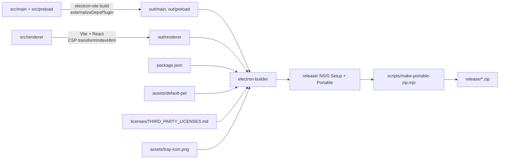

# FlowerBuddy 架构概览

> 状态：**当前事实**。本文按源码记录 2026-10-17、提交 `a635bb9` 的实际架构。
> 代码变化后必须同步本文；无法从源码确认的内容会标为“待核实”。
> 原始产品规划见 [Windows_桌宠个人助手_技术开发文档.md](../../Windows_桌宠个人助手_技术开发文档.md)，该文档不是当前实现清单。

## 1. 进程与职责边界

| 层            | 位置                | 职责                                                                                            | 明确不负责                                                            |
| ------------- | ------------------- | ----------------------------------------------------------------------------------------------- | --------------------------------------------------------------------- |
| Electron main | `src/main/`         | 应用生命周期、窗口、托盘、系统通知、配置/凭据/数据存储、外部 API 请求、调度、IPC 校验与错误映射 | 渲染界面、保存明文凭据到普通配置、向 renderer 暴露 Node/Electron 能力 |
| Preload       | `src/preload/`      | 按窗口视图暴露窄 `contextBridge` API；包装 `ipcRenderer.invoke/on`；解包 `IpcResult`            | 业务逻辑、凭据读取、任意 channel 或文件访问                           |
| Renderer      | `src/renderer/`     | React UI：桌宠、快捷菜单、气泡、设置页；收集输入、展示状态                                      | 直接访问 Node/Electron、外部 API、密钥、任意文件路径                  |
| Shared        | `src/shared/api.ts` | 主进程、preload、renderer 共享的类型、窗口视图和 IPC 通道名                                     | 保存凭据或运行时状态                                                  |

窗口统一通过 `src/main/security/web-preferences.ts` 创建，关键选项为：

- `nodeIntegration: false`
- `contextIsolation: true`
- `sandbox: true`
- `webviewTag: false`
- `navigateOnDragDrop: false`
- `additionalArguments: ['--fb-view=<view>']`

`src/main/index.ts` 还统一拒绝所有权限请求：

```ts
session.defaultSession.setPermissionRequestHandler((_webContents, _permission, callback) =>
  callback(false)
)
session.defaultSession.setPermissionCheckHandler(() => false)
```

> 待核实：源码中未找到 `setWindowOpenHandler` 或 `will-navigate` 拦截。当前该事项登记在 [OPEN_ITEMS.md](../OPEN_ITEMS.md)，不要把它写成已实现的安全能力。

## 2. 目录与关键入口

```text
src/
  main/
    index.ts                     # 启动、依赖装配、单实例、退出清理
    app-controller.ts            # 窗口/模块/托盘/动作的协调者
    actions/module-action-runner.ts
    ipc/register-handlers.ts     # 所有 ipcMain.handle 注册
    ipc/schemas.ts               # Zod 输入 schema
    ipc/validate-sender.ts       # senderFrame.url 校验
    modules/
      registry.ts                # 静态模块注册表
      module-manager.ts          # enabled && configured 生命周期
      types.ts                   # ModuleDefinition / ModuleContext
      dates/ gmail/ esa/ deepseek/ website-check/
    protocol/pet-asset-protocol.ts
    scheduler/task-scheduler.ts
    security/
      web-preferences.ts
      secret-store.ts
      secret-ids.ts
      safe-storage-backend.ts
    shared/errors.ts
    shared/logger.ts
    storage/
      config-store.ts
      config-schema.ts
      json-store.ts
      pet-assets.ts
    tray/tray.ts
    windows/
      pet-window.ts
      pet-window-controller.ts
      settings-window.ts
      overlay-windows.ts
      overlay-window-manager.ts
      geometry.ts
      load-view.ts
  preload/
    index.ts                     # contextBridge 入口
    api.ts                       # createBridge / 按视图创建 API
    index.d.ts                   # window.*Api 类型声明
  renderer/
    index.html                   # CSP 占位符与 Vite 入口
    src/
      main.tsx                   # React 根与全局样式
      App.tsx                    # 按 ?view= 选择视图
      pet/ menu/ bubbles/        # 常驻视图
      settings/                  # 懒加载设置应用、8 个 tab、6 个 hook
      components/                # Button / Field / Tag / EmptyState 等
      styles/                    # tokens.css + 各视图样式
  shared/api.ts                  # 共享类型与 IPC_CHANNELS
tests/unit/                      # Vitest 单元测试
scripts/                         # 图标、默认形象、许可证、便携 ZIP
```

## 3. 启动与退出流程

启动入口为 `src/main/index.ts` 的 `bootstrap()`：

1. 设置 AppUserModelID、浅色主题，移除应用菜单。
2. 拒绝所有权限请求。
3. 在 `app.getPath('userData')` 下创建并加载：`Logger`、`ConfigStore`、`SecretStore`、两个 `JsonStore`（日期/网站）、`Gmail` 状态存储。
4. 创建 `TaskScheduler`、各业务 service/module、`ModuleManager` 和 `AppController`。
5. 注册 Gmail 新邮件回调、桌宠图片协议处理器、IPC handlers。
6. 监听 `powerMonitor` 的 `resume`，调用 `ModuleManager.handleResume()` 重新计时。
7. `AppController.start()`：应用开机启动设置、创建桌宠窗口、托盘、启动模块，并监听显示器变化。

单实例：

- `app.requestSingleInstanceLock()` 失败时直接退出。
- 第二个实例触发 `second-instance`，已有实例显示桌宠并打开设置。

退出：

- 关闭所有窗口不会退出应用（`window-all-closed` 为空实现），符合“桌宠常驻托盘”的产品设计。
- `before-quit` 中调用 `AppController.flush()` 写入待保存数据，再调用 `dispose()` 停止模块、动作计时器、overlay、屏幕监听和托盘。

## 4. 窗口与 renderer 视图

一个 Vite renderer 工程通过 `?view=` 渲染四种视图；窗口类型与视图一一对应：

| 视图       | 窗口创建                     | 加载方式                        | 主要行为                                               |
| ---------- | ---------------------------- | ------------------------------- | ------------------------------------------------------ |
| `pet`      | `windows/pet-window.ts`      | `loadView(..., view: 'pet')`    | 透明、无边框、默认置顶、不可聚焦、拖动与点击打开菜单   |
| `menu`     | `windows/overlay-windows.ts` | 按需创建，`waitForLoad` 后显示  | 相对桌宠定位，失焦隐藏，重复打开有 250 ms 保护         |
| `bubble`   | `windows/overlay-windows.ts` | 按需创建，`waitForLoad` 后显示  | `showInactive()`，接收 `bubble:update` 推送            |
| `settings` | `windows/settings-window.ts` | 单例窗口，780×720，最小 640×540 | 设置、模块管理、日期、网站、Gmail、DeepSeek、ESA、外观 |

加载规则（`windows/load-view.ts`）：

- 开发环境：`<devServerUrl>/?view=<view>`。
- 生产环境：`loadFile(rendererIndexPath, { query: { view } })`。

preload 通过 `--fb-view=<view>` 参数决定暴露哪个 API：

| 视图       | 暴露对象             | 类型          |
| ---------- | -------------------- | ------------- |
| `pet`      | `window.petApi`      | `PetApi`      |
| `menu`     | `window.menuApi`     | `MenuApi`     |
| `bubble`   | `window.bubbleApi`   | `BubbleApi`   |
| `settings` | `window.settingsApi` | `SettingsApi` |

`src/preload/index.ts` 与 `src/renderer/src/App.tsx` 分别从启动参数和 URL 查询参数读取视图，两者由 `loadView` 保证一致。新增视图时必须同时修改 `WindowView`、`IPC_CHANNELS`/API 类型、`BRIDGE_KEYS`、`App.tsx` 和窗口创建逻辑。

## 5. IPC 方向、校验与响应

### 5.1 调用方向

```mermaid
flowchart LR
  subgraph Renderer[Renderer 不可信 UI]
    R[React 视图]
  end
  subgraph Preload[Preload 窄桥]
    P[window.petApi / menuApi / bubbleApi / settingsApi]
  end
  subgraph Main[Electron main 可信层]
    H[ipc/register-handlers.ts]
    C[AppController]
    M[ModuleManager]
    S[TaskScheduler]
    X[业务 service / 外部 API]
    W[窗口 / 托盘 / overlay]
    D[ConfigStore / JsonStore / SecretStore]
  end

  R -->|调用 API| P
  P -->|ipcRenderer.invoke(channel, input)| H
  H -->|sender 校验 + Zod 校验| C
  C --> M
  M --> S
  M --> X
  C --> W
  C --> D
  H -->|IpcResult<T>| P
  P -->|解包或抛出 PublicError| R
  W -->|pet:state-changed / bubble:update| P
```

### 5.2 请求响应

`register-handlers.ts` 为每个 channel 包装统一逻辑：

1. `assertTrusted(event)`：`event.senderFrame?.url` 必须是打包后的 `index.html` 文件 URL，或开发服务器 origin（`validate-sender.ts`）。
2. 有 schema 时执行 `parseInput`；失败抛 `AppError('INVALID_INPUT', ...)`。
3. 成功返回 `{ ok: true, value }`。
4. 失败通过 `toPublicError` 返回 `{ ok: false, error: { code, message, retryable } }`，并记录不含敏感字段的 warn 日志。

preload 的 `unwrapResult` 把 `IpcResult` 解包；失败时抛出一个可序列化的普通对象（保留 `code`/`message`/`retryable`），因为 `contextBridge` 会丢弃自定义 Error 属性。

### 5.3 推送

主进程向 renderer 主动发送的事件只有：

- `pet:state-changed` → `pet` 视图（形象与弹跳设置变化）。
- `bubble:update` → `bubble` 视图（`BubblePayload`）。

renderer 不通过 IPC 主动请求外部网络；所有外部请求由主进程发起。

### 5.4 通道定义

所有通道名集中在 `src/shared/api.ts` 的 `IPC_CHANNELS`，按前缀分组：`app:`、`config:`、`settings:`、`modules:`、`security:`、`dates:`、`websites:`、`deepseek:`、`esa:`、`gmail:`、`menu:`、`pet:`、`bubble:`。

新增 IPC 的最小改动面：

1. `IPC_CHANNELS` 增加通道名。
2. `src/shared/api.ts` 增加输入/输出类型和对应 `*Api` 方法。
3. `src/preload/api.ts` 增加调用包装。
4. `src/main/ipc/schemas.ts` 增加 Zod schema。
5. `src/main/ipc/register-handlers.ts` 注册 handler，并由 `AppController` 暴露方法。
6. 更新测试、架构文档和手动测试计划。

## 6. 模块生命周期与调度

### 6.1 静态注册表

`src/main/modules/registry.ts` 返回固定模块数组，不读取文件系统、不执行动态插件代码：

- `DatesModule`
- `GmailModule`
- `EsaModule`
- `DeepSeekModule`
- `WebsiteCheckModule`

每个模块实现 `ModuleDefinition`（`src/main/modules/types.ts`）：

```ts
interface ModuleDefinition {
  id: ModuleId
  name: string
  description: string
  requiresCredentials: boolean
  implemented: boolean
  actions: ModuleActionDefinition[]
  isConfigured(): boolean
  getStatus(): ModuleStatus
  start(context: ModuleContext): void
  stop(): void
  runAction?(actionId: string): Promise<ModuleActionResult>
}
```

### 6.2 ModuleManager

`ModuleManager`（`src/main/modules/module-manager.ts`）是生命周期的唯一协调者：

- 只有 `enabled && isConfigured()` 的模块会被 `start()`。
- `setEnabled()`、`refresh()` 会停止并重新同步对应模块。
- `stopModule()` 会调用模块 `stop()`，再 `scheduler.stopByOwner(module.id)`。
- `getMenuActions()` 只列出 `implemented && configured && enabled` 且有动作的模块。
- `runAction()` 会再次校验模块实现、配置和启用状态，并抛出 `UNKNOWN_ACTION` / `NOT_CONFIGURED` / `MODULE_DISABLED`。

### 6.3 TaskScheduler

`src/main/scheduler/task-scheduler.ts` 的特性：

- 每个任务一条 `setTimeout` 链；同一任务不会重叠运行。
- 失败后按 `intervalMs * 2^failures` 指数退避，上限默认 30 分钟。
- `stop()` / `stopByOwner()` / `stopAll()` 清 timer 并 `AbortController.abort()` 中止在途任务。
- `handleResume()` 在系统休眠恢复后从当前时间重新计时，不补发错过的执行。
- 业务模块通过 `ModuleContext.scheduler` 注册任务，不自行创建永久 `setInterval`。

当前任务来源：

| 模块     | 任务                 | 间隔                           | 备注                                 |
| -------- | -------------------- | ------------------------------ | ------------------------------------ |
| Gmail    | `gmail:poll`         | 1–15 分钟，默认 3              | 只在已配置时启动；授权失效时停止轮询 |
| DeepSeek | `deepseek:refresh`   | 5–60 分钟或关闭                | 配置了刷新间隔才注册                 |
| ESA      | `esa:refresh`        | 5–60 分钟或关闭                | 配置了刷新间隔才注册                 |
| 网站检测 | `website-check:<id>` | 每个启用且设置了间隔的网站一条 | 配置变化后重建任务                   |

### 6.4 快捷菜单动作与气泡

- 菜单列出 `ModuleManager.getMenuActions()` 的结果。
- `ModuleActionRunner`（`src/main/actions/module-action-runner.ts`）负责：
  - 生成 `requestId`，新请求使旧结果失效；
  - 先显示 loading 气泡，再显示 success/empty/error；
  - 45 秒安全超时；
  - 按 `app.bubbleDurationMs` 自动隐藏；
  - 有前台动作或桌宠不可见时，后台通知不抢占气泡。
- Gmail 新邮件由 `AppController.handleGmailNewMessages()` 处理：可发 Windows 通知，并通过 `showBackground()` 显示气泡。

## 7. 数据、凭据与日志

所有可变数据写入 `app.getPath('userData')`，不写入安装目录：

| 文件/目录                  | 内容                                                                | 写入者                   | 安全处理                                                                                              |
| -------------------------- | ------------------------------------------------------------------- | ------------------------ | ----------------------------------------------------------------------------------------------------- |
| `config.json`              | 应用设置、桌宠配置、模块开关、非敏感配置（如 ESA SiteId、轮询间隔） | `ConfigStore`            | `schemaVersion` 当前为 4；Zod 修复非法值；未来版本/损坏文件备份后重置；150 ms 防抖；临时文件 + rename |
| `secrets.enc.json`         | 加密后的 API Key、AccessKey、OAuth Client/Refresh Token             | `SecretStore`            | 仅保存 Base64 密文；`safeStorage` 异步加密；不可用时拒绝保存，不回退明文                              |
| `data/dates.json`          | 日期事件                                                            | `JsonStore<DatesData>`   | `sanitizeDatesData` 修复非法输入；原子写入                                                            |
| `data/website-checks.json` | 网站检测配置与最近结果                                              | `JsonStore<WebsiteData>` | `sanitizeWebsiteData`；结果只保留展示字段                                                             |
| `data/gmail-state.json`    | 邮箱地址、`historyId`、已通知消息 ID、授权失效标记                  | `JsonStore<GmailState>`  | 不保存正文；消息 ID 有上限                                                                            |
| `pets/<uuid>.png`          | 用户导入的桌宠图片                                                  | `storage/pet-assets.ts`  | 仅 PNG，≤15 MB，尺寸 ≤8192；随机 UUID 文件名                                                          |
| `logs/app.log`             | JSON Lines 脱敏日志                                                 | `Logger`                 | 密钥/token/邮件主题等脱敏；2 MB 轮转；保留 7 天                                                       |

凭据 ID（`src/main/security/secret-ids.ts`）：

- `deepseek.apiKey`
- `esa.accessKeyId`
- `esa.accessKeySecret`
- `gmail.clientId`
- `gmail.clientSecret`
- `gmail.refreshToken`

凭据只在主进程读取；`SecretStore` 对 ID 做格式校验，密文以外不落盘。渲染进程没有读取明文的 IPC 接口。

桌宠图片访问：

- 自定义协议 `flowerbuddy-pet://asset/<assetId>` 在 app ready 前注册为 privileged scheme。
- `handlePetAssetRequests` 只接受当前配置的 assetId 或内置 `default`；`resolvePetAssetPath` 只解析内置路径或 UUID 文件名，无法读取任意文件。

## 8. 外部网络访问

| 服务       | 目标                                                                  | 触发条件                                               | 超时/限制                                                                 |
| ---------- | --------------------------------------------------------------------- | ------------------------------------------------------ | ------------------------------------------------------------------------- |
| DeepSeek   | `GET https://api.deepseek.com/user/balance`                           | 模块启用且已配置 API Key，用户手动查询或设置了刷新间隔 | 15 秒；401/402/429/5xx 映射为 `AppError`                                  |
| 阿里云 ESA | 官方 SDK `@alicloud/esa20240910`，端点 `esa.cn-hangzhou.aliyuncs.com` | 模块启用、AccessKey 与 SiteId 已配置                   | 连接 5 秒、读取 15 秒；本地自然日 00:00 到现在转 UTC；`Traffic` / `ALL`   |
| Gmail      | Google OAuth 2.0 + Gmail API                                          | 模块启用且已连接                                       | OAuth 回环回调 5 分钟；请求 25 秒；每轮最多 25 封元数据；`gmail.readonly` |
| 网站检测   | 用户自行添加的 HTTP(S) URL                                            | 用户手动检测或启用定时检测                             | 3–30 秒；手动跟随最多 5 次重定向；不读取响应正文                          |

Gmail 流程要点：

- 系统浏览器打开授权页，`127.0.0.1` 随机端口回环回调，PKCE + 随机 `state`。
- 首次连接只建立 `historyId` 基线，不把历史邮件当作新邮件。
- 使用 History API 增量读取，按 Message ID 去重；`historyId` 失效时重建基线。
- 授权失效写入 `authExpired` 并停止轮询；断开时尽力在线撤销并删除本地 token。
- 仅读取 `From`、`Subject`、`Date`、消息 ID 等元数据。

## 9. 构建与打包数据流



事实要点：

- `electron.vite.config.ts` 对 main/preload 使用 `externalizeDepsPlugin()`；renderer 使用 React 插件和 CSP 注入插件。
- 开发 CSP 允许 React Refresh 内联脚本和本地 HMR WebSocket；生产 CSP 为 `default-src 'none'`、`script-src 'self'`。
- `electron-builder.yml`：`asar: true`，打包 `out/**/*`、`package.json`、`assets/default-pet/**/*`，输出到 `release/`；Windows x64 生成 NSIS 和 portable。
- `extraResources` 带入第三方许可证和托盘图标。
- `scripts/make-portable-zip.mjs` 在 `dist:win` 末尾生成便携 ZIP。
- CI（`.github/workflows/ci.yml`）在 `windows-latest` 运行 typecheck、lint、format:check、test、build；tag 或手动触发时额外打包并上传产物。

## 10. 依赖方向与禁止的反向依赖

允许的方向：

```text
shared  ←  main
shared  ←  preload
shared  ←  renderer（仅类型/常量）
main    ←  preload（不得导入）
main    ←  renderer（不得导入）
```

具体约束：

- `src/shared/` 不得导入 main、preload 或 renderer 的运行时模块。
- `src/main/` 可以依赖 `shared`；其中的 `storage`、`security`、`shared` 是下层，不应反向依赖 `windows`、`ipc`、`tray` 或 `app-controller`。
- 业务模块（`src/main/modules/*`）依赖共享类型、存储、安全、调度和自身 service；不得依赖窗口、托盘、IPC 注册或 `AppController`。
- `src/preload/` 只依赖 `shared` 和 Electron；不得导入主进程业务代码。
- `src/renderer/` 通过 `window.*Api` 与主进程交互；不得导入主进程或 preload 的运行时模块，只能使用共享类型和 `preload/index.d.ts` 声明。
- `windows/` 负责窗口创建与几何，不承担外部 API 调用；`AppController` 负责编排，不把模块专属网络逻辑塞回协调器。

## 11. 安全边界摘要

- 所有窗口使用统一安全 `webPreferences`；权限请求全部拒绝。
- 每个 IPC handler 校验 sender URL 和输入 schema；错误只返回公开字段。
- 凭据只在主进程解密；普通配置、日志和渲染进程都不含明文凭据。
- 日志统一脱敏，元数据键名包含 `secret`、`token`、`email`、`subject`、`body` 等会被替换。
- 生产 renderer 只加载本地文件并注入严格 CSP。
- 桌宠图片通过受限自定义协议提供。
- 待核实：导航与 `window.open` 拦截尚未在源码中确认，见 [OPEN_ITEMS.md](../OPEN_ITEMS.md)。

## 12. 与旧规划文档的已知差异

`Windows_桌宠个人助手_技术开发文档.md` 是最初的完整规划，以下内容与当前实现不同，阅读时不要当成现状：

| 旧规划                                               | 当前实现                                                                           |
| ---------------------------------------------------- | ---------------------------------------------------------------------------------- |
| 目录示例使用 `service.ts` / `schema.ts` / `oauth.ts` | 实际使用 `*-service.ts`、`*-module.ts`、`types.ts`、`gmail-auth.ts` 等             |
| 配置 schema 示例为 `schemaVersion: 1`                | 当前 `CURRENT_CONFIG_SCHEMA_VERSION = 4`                                           |
| 规划 `notifications/notification-service.ts`         | 当前由 `AppController.handleGmailNewMessages()` 直接使用 Electron `Notification`   |
| 规划设置页“打开日志目录 / 复制脱敏诊断信息”          | 尚未实现，登记在 `OPEN_ITEMS.md`                                                   |
| 规划目录包含 `tests/integration/`                    | 当前只有 `tests/unit/`                                                             |
| 阶段任务是“从零开发”计划                             | 阶段 0–6 已完成；历史产物见 `docs/regression-report.md` 与 `docs/performance-*.md` |

## 13. 维护要求

- 修改窗口/视图、IPC 通道、模块生命周期、存储位置、构建产物或依赖方向时，必须同步更新本文。
- 本文只写能从源码核对的事实；计划或建议写入 `OPEN_ITEMS.md` 或明确标注。
- 新增架构说明优先追加到本文；只有 IPC 契约增长到难以导航时，才单独拆出 `ipc-contracts.md`。
